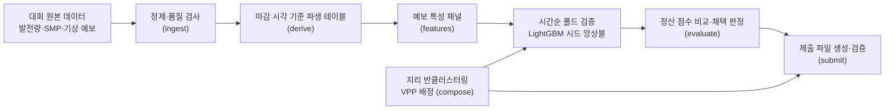

# OIBC 2026

**태양광 발전소 253곳을 두 개의 가상발전소(VPP)로 나누고, 각 VPP의 하루 전 시간별 발전량을 예측해 정산 수익을 높이는 프로젝트**

[](./pyproject.toml) [](./src/oibc/models/gbm.py) [](./uv.lock)

> [!NOTE]
> 2026 POSTECH OIBC 빅데이터 경진대회 참가 프로젝트입니다. 대회 제출 기간(2026-11-02 ~ 11-13) 전이라 **리더보드 점수와 순위는 없습니다.** 대회 데이터와 실험 결과 파일은 포함하지 않습니다.

## 🧭 개요

**대회 개요** ([대회 소개 페이지](https://www.theteams.kr/activities/page/353328/lc) 기준)

- 국내 태양광 발전소는 대부분 100kW급이라 전력시장에 혼자 참여하기 어렵고, 여러 발전소를 묶은 VPP로 정산됩니다.
- 하루 전에 낸 발전량 예측이 실제와 얼마나 맞는지에 따라 보상과 벌점이 정해집니다.
- 참가자는 (1) 발전소를 두 그룹으로 나누고 (2) 각 그룹의 시간별 발전량을 예측합니다. 예측 대상 기간은 2025-06-01 ~ 2026-06-01(8,760시간)입니다.

**정산 방식** (대회 규정을 코드에 옮긴 것: [`config.py`](./src/oibc/config.py), [`settlement.py`](./src/oibc/evaluate/settlement.py))

`S = Σ SMP·실제 발전량 − 0.10 × Σ SMP·k·|예측 − 실제|`

- SMP는 시간별 전력 가격입니다. `k`는 11~15시에 3, 나머지 시간에 1입니다.
- 벌점은 그룹별로 계산해 더합니다. 같은 그룹 안에서는 발전소마다 오차의 부호가 달라 서로 상쇄될 수 있지만, 그룹 사이에서는 상쇄되지 않습니다. 그래서 **어떻게 나누느냐**가 점수에 영향을 줍니다.

**제약 조건**

- 253개 발전소를 모두 두 그룹 중 하나에 한 번씩만 배정하고, 평가 기간 내내 같은 배정을 씁니다.
- 각 그룹의 설비 용량은 20,000kW 이상이어야 합니다.
- 예측은 전날 17:00(KST)까지 알 수 있는 정보만 써야 합니다. 대회가 준 데이터만 쓸 수 있습니다.

이 프로젝트는 위 규칙을 어기지 않는 것을 최우선으로 두고, 정산 점수 `S`를 기준으로 방법을 비교하는 **재현 가능한 파이프라인**을 만드는 데 집중했습니다.

## 🏗️ 시스템 구성



단계마다 명령어가 하나씩 있고([`pipeline.py`](./src/oibc/pipeline.py)), 입력이 규칙에 어긋나면 기본값으로 대체하지 않고 오류로 멈춥니다.

## 🔧 핵심 설계 결정

### ⏱️ 1. 예측 마감 시각을 코드로 강제한 이유

- **문제:** 전날 17:00 이후의 정보를 쓰면 안 되는데, 시계열 데이터는 실수로 미래 정보가 섞이기 쉽습니다.
- **분석:** 모델이 아니라 데이터 단계에서 막아야 한다고 판단했습니다. 모델 쪽에서 조심하는 방식은 특성이 늘수록 빈틈이 생깁니다.
- **선택:** 파생 테이블을 만들 때 마감 시각 기준의 게이트를 거치게 했습니다([`gate.py`](./src/oibc/data/gate.py)). 모든 시각은 KST 오른쪽 닫힘 구간(`01:00` = 00~01시)으로 통일하고([`timeaxis.py`](./src/oibc/timeaxis.py)), 마감 이후 예보를 망가뜨려도 이전 날의 특성이 바뀌지 않는지 테스트합니다([`test_gate.py`](./tests/unit/oibc/data/test_gate.py)).
- ✅ **결과:** 정산·시간축·마감 규칙을 단위 테스트로 고정했습니다([`tests/`](./tests/unit/oibc)).

### 🎯 2. 평균이 아니라 정산 점수로 모델을 평가한 이유

- **문제:** 정산 벌점은 절댓값 오차에 가격(SMP)과 시간 가중치(`k`)를 곱한 값이라, 보통의 RMSE와 최적 지점이 다릅니다.
- **분석:** 절댓값 오차를 줄이는 예측은 평균이 아니라 중앙값입니다. 가격이 0인 시간의 오차는 비용이 없고, 11~15시 오차는 3배 비용입니다.
- **선택:** LightGBM의 목적함수를 L1로 쓰고, 학습 가중치를 `SMP × k × 용량`으로 두어 평가와 같은 기준으로 학습합니다([`gbm.py`](./src/oibc/models/gbm.py), `--weight smp_k_cap`). 비교는 MAE가 아니라 정산 벌점 `W`로 합니다.
- ✅ **결과:** 학습과 평가가 같은 기준을 쓰는 구조입니다. 개선 수치는 아직 없습니다(결과 항목 참고).

### 🧪 3. 실험을 "채택 규칙"으로 판정한 이유

- **문제:** 같은 검증 데이터로 실험을 반복하면 우연히 좋아 보이는 설정을 고르게 됩니다. 리더보드 점수에 맞춰 고치는 것도 같은 문제입니다.
- **분석:** 시드를 바꾸면 결과가 흔들리므로, 그 흔들림보다 큰 개선인지 따져야 합니다.
- **선택:** 학습 시작 전에 규칙을 정해 두었습니다([`config.py`](./src/oibc/config.py)의 `ValidationConfig`, [`compare.py`](./src/oibc/evaluate/compare.py)).
  - 시간순 폴드 2개(2023-06~2024-05, 2024-06~2025-05)와 시드 3개, 폴드 앞뒤 1일 간격.
  - 7일 블록 부트스트랩 신뢰구간이 0을 포함하지 않을 것, 시드 잡음의 2배(`noise_z`)를 넘을 것, 최소 1% 개선, 분기별 70% 이상에서 개선.
  - 코드 버전이나 입력 패널이 다른 실행끼리는 비교하지 않습니다([`registry.py`](./src/oibc/evaluate/registry.py)).
- ✅ **결과:** 실험마다 가설, 설정, 시드, 패널 해시를 기록하고 "채택/기각/판정 불가" 중 하나로 남깁니다.

### 🗺️ 4. VPP 배정을 지리 반클러스터링으로 시작한 이유

- **문제:** 253곳을 두 그룹으로 나누는 경우의 수는 너무 많고, 배정을 잔차로 최적화하면 모델이 이미 외운 데이터의 오차로 "가짜 상쇄"를 만들 수 있습니다.
- **분석:** 주변 발전소는 같은 날씨를 겪어 오차 방향이 비슷합니다. 가까운 발전소를 **서로 다른 그룹에 나눠 담으면** 각 그룹이 지역 전체를 닮게 되어 그룹 사이 편차가 줄어든다는 가정입니다(가정이며 검증 대상입니다).
- **선택:** 용량 가중 K-means로 64개 지역으로 나눈 뒤, 지역마다 용량을 두 그룹에 번갈아 배분하고 용량 하한(20,000kW)을 맞춥니다([`anticluster.py`](./src/oibc/compose/anticluster.py)). 무작위 배정, 용량 균형 배정과 같은 조건에서 비교하는 도구도 있습니다([`netting.py`](./src/oibc/evaluate/netting.py)).
- ✅ **결과:** 배정이 제약(253곳 한 번씩, 용량 하한)을 만족하는지 검증하는 코드와 테스트가 있습니다([`constraints.py`](./src/oibc/compose/constraints.py)). 배정의 실제 효과는 아직 검증하지 않았습니다.

### 🧩 5. 예측 모델을 단계적으로 늘린 방식

- **문제:** 복잡한 모델이 단순한 모델보다 낫다는 보장이 없습니다.
- **분석:** 발전소 단위로 예측해 합치는 방식과, 지역 단위 합계를 직접 예측하는 방식은 장단점이 달라 같은 폴드에서 비교해야 합니다.
- **선택:** 기본은 발전소 단위 LightGBM 시드 앙상블입니다. 그 위에 선택적으로 지역 합계 직접 예측([`regional.py`](./src/oibc/models/regional.py)), CatBoost·MLP 혼합([`families.py`](./src/oibc/models/families.py)), 운량 기반 선형 사후 보정([`calibrate.py`](./src/oibc/models/calibrate.py))을 얹을 수 있고, 혼합 비율은 기본 0(꺼짐)입니다. 보정은 교차 적합 보고서에서 "채택" 판정을 받은 경우에만 제출에 쓰입니다.
- ✅ **결과:** 각 요소를 켜고 끄는 옵션이 있어 같은 규칙으로 비교할 수 있습니다.

## 📊 결과

**아직 보고할 점수가 없습니다.** 대회 제출 기간이 시작되기 전이고, 현재 확인할 수 있는 것은 다음과 같습니다.

- ✅ 파이프라인: 정제 → 파생 → 특성 → 검증 → 제출까지 명령어로 이어집니다.
- ✅ 제출 파일 검증기: 253곳 배정, 용량 하한, 시간 개수, 비음수·유한 값, 시간대 포함 여부를 확인합니다([`validate.py`](./src/oibc/submit/validate.py)).
- ✅ 단위 테스트: `tests/unit/oibc/` 아래 모듈별 테스트가 있습니다.

## ⚠️ 한계

- 대회 점수, 순위, 검증 개선 폭은 아직 없습니다.
- 지리 반클러스터링이 실제로 벌점을 줄이는지는 검증 결과로 확인해야 하는 가정입니다.
- 검증용 마지막 12개월은 이미 모델 비교에 쓰여 완전한 검증용 데이터가 아닙니다. 평가 기간은 리더보드만이 유일한 시험이며, 제출 횟수가 정해져 있어 리더보드에 맞춘 조정은 하지 않는 것을 원칙으로 했습니다.
- 재현하려면 대회 원본 데이터가 필요한데 공개할 수 없어 학습을 돌릴 수 없습니다.

## 🧱 기술 스택

| 구분 | 사용 기술 |
| :--- | :--- |
| 언어·환경 | Python 3.12, uv |
| 모델 | LightGBM(L1), CatBoost, scikit-learn(K-means, MLP) |
| 데이터 | pandas, NumPy, PyArrow(Parquet), SciPy |
| 설정·검증 | Pydantic |
| 품질 | pytest, ruff, mypy(`tools/verify.py`) |

## 📂 프로젝트 구조

```text
src/oibc/
├── config.py       # 대회 상수, 검증·모델 설정(타입 있는 설정 객체)
├── pipeline.py     # 명령어 진입점
├── timeaxis.py     # KST 오른쪽 닫힘 시간축, k 가중치
├── solar.py        # 태양 고도·맑은 날 일사량 계산
├── data/           # 원본 정제, 품질 검사, 마감 시각 게이트, 파생 테이블
├── features/       # 예보 특성 패널
├── cv/             # 시간순 폴드 분할
├── models/         # LightGBM, 지역 모델, CatBoost·MLP, 운량 보정
├── compose/        # VPP 배정 (반클러스터링, 제약 검증)
├── evaluate/       # 정산 계산, 상쇄 분해, 비교·채택 판정, 실험 기록
├── train/          # 폴드 검증·평가 구간 예측 실행기
└── submit/         # 제출 파일 생성·검증
tests/unit/oibc/    # 모듈별 단위 테스트
tools/verify.py     # 린트·타입·테스트·변경분 커버리지 검사
```

## 🚀 시작하기

대회 원본 데이터를 `data/raw/01_participant_dataset/`에 넣어야 합니다(공개 불가).

```bash
uv sync                                   # 의존성 설치
uv run python tools/verify.py             # 린트, 타입, 테스트
uv run pytest                             # 테스트만

uv run python -m src.oibc.pipeline ingest
uv run python -m src.oibc.pipeline derive
uv sync --group external                  # 외부 GFS 수집 의존성
uv run python -m src.oibc.pipeline gfs-fetch      # dynamical.org GFS 상자 npz
uv run python -m src.oibc.pipeline gfs-audit      # NOAA 원본 공개 시각 감사
uv run python -m src.oibc.pipeline gfs-hourly     # 대상일 시간별 광역 요약
uv run python -m src.oibc.pipeline ecmwf-fetch    # ECMWF Open Data ssrd 상자 npz (00z D-1, 18z D-2, 12z D-2)
uv run python -m src.oibc.pipeline ecmwf-audit    # S3 원본 LastModified로 실행별 공개 시각 감사
uv run python -m src.oibc.pipeline features
uv run python -m src.oibc.pipeline compose --comp-id <배정 이름>
uv run python -m src.oibc.pipeline validate-run --run-id <이름> --hypothesis "<가설>"
uv run python -m src.oibc.pipeline submit --run-id <이름> --sub-id <제출 이름>
uv run python -m src.oibc.pipeline scale-submission --base-sub <제출> --scale 0.97 --months 11 12 1 2 --sub-id <제출 이름>
uv run python -m src.oibc.pipeline ecmwf-correct --base-sub <제출> --sub-id <제출 이름>   # ECMWF 2단 보정
uv run python -m src.oibc.pipeline validate-submission --composition <composition.csv> --forecast <forecast.csv>
```

dynamical.org 저장소를 쓸 수 없으면 `gfs-fetch --source noaa`로 NOAA 원본 GRIB(`noaa-gfs-bdp-pds`)에서 같은 형식의 파일을 만듭니다. 이미 있는 파일은 건드리지 않습니다. 대역폭은 init당 약 150MB이고, 전체 기간은 약 270GB입니다. 두 경로가 같은 특성을 만드는지는 `gfs-compare`(기본 표본 24개 init)로 확인합니다.

## 🤖 개발 과정에서의 AI 활용

AI 도구는 주로 코드를 쓰는 데 사용했고, 아이디어를 정리하고 도메인(전력 정산, 태양광) 개념을 공부하는 데도 썼습니다. **수치와 동작은 직접 확인했습니다.**

| AI에 맡긴 일 | 직접 한 일 |
| :--- | :--- |
| 코드 작성 | 규칙(마감, 정산식, 제약)을 확인해 코드 규칙으로 정리 |
| 아이디어 정리, 도메인 개념 학습 보조 | 결과 수치와 동작 확인 |

## 📚 참고

- [2026 POSTECH OIBC 빅데이터 경진대회 소개](https://www.theteams.kr/activities/page/353328/lc)
- 정산식과 제약은 대회 참가자 안내를 따랐고, 코드 상수에 반영되어 있습니다([`config.py`](./src/oibc/config.py)).
