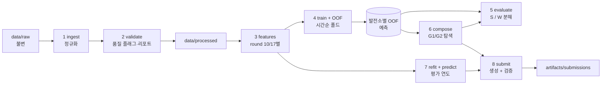

# OIBC-2026 아키텍처 개요

## 1. 한 줄 요약

```
maximize  S = Σ_t SMP(t)·(A₁+A₂)(t)  −  0.10 · Σ_g Σ_t SMP(t)·k(t)·|F_g(t) − A_g(t)|
                └── 상수 (전체 발전소 합계로 결정) ┘   └────────── W (우리가 통제하는 항) ──────────┘
```

| 의사결정 | 변수 | `W`에 미치는 영향 |
|---|---|---|
| 구성 | 253개 발전소 → `G1`/`G2`, 각 20,000 kW 이상, 1년간 고정 | 집합 **내부**의 오차 상쇄 |
| 예측 | 2개 집합 × 8,760시간의 `F_g(t)` | 집합 합계의 가중 L1 오차 |

설계 전반을 결정하는 결론:
- 매전수익 항은 배정과 무관 → **`W`만 최소화**한다.
- 손실이 `SMP·k` 가중 **L1** → 조건부 **중앙값**을 목표로 하고, 시간별 가중치(11~15시 ×3, SMP=0은 비용 없음)를 적용한다.
- 오차 상쇄 계산에는 **발전소 단위 OOF(out-of-fold) 잔차**가 필요 → 발전소 단위 예측이 평가와 구성이 공유하는 핵심 산출물이다.

## 2. 전체 파이프라인



| # | 단계 | 입력 → 출력 | 중단(fail-closed) 조건 |
|---|---|---|---|
| 1 | `ingest` | 원본 CSV/Parquet → 타입 정규화된 Parquet | 스키마·dtype·타임존 불일치 |
| 2 | `validate` | 정규화 데이터 → 같은 행 + `dq_*` 플래그 + 품질 리포트 | 키 깨짐, `smp` 격자 공백, 미지의 관측지점 |
| 3 | `features` | processed → `(site, ts, round)` 피처 패널 | 컷오프 이후 입력, 채점 격자 대비 행 손실 |
| 4 | `train` | 피처 + 폴드 → 모델 + OOF 발전소 예측 | 폴드 중첩·엠바고 위반 |
| 5 | `evaluate` | 예측 + 실적 + 배정 → `S`, `W`, 분해 지표 | 시각 정렬 불일치 |
| 6 | `compose` | OOF 잔차 → 배정 | 용량 < 20,000 kW, 분할 아님 |
| 7 | `predict` | 전체 학습 구간 재학습 → 평가 연도 발전소별 예측 | 채점 시각 누락 |
| 8 | `submit` | 배정 + 예측 → CSV 2개 + manifest | 제출 계약 위반 |

각 단계는 파일 기반의 순수 함수다. 단독 재실행이 가능하고, 멱등이며, 숨은 상태가 없다.

## 3. 데이터 레이아웃

```
data/
├── OIBC_2026_DATA.zip            # 다운로드 원본 (수정 금지)
├── raw/01_participant_dataset/   # 압축 해제본, 읽기 전용
├── processed/                    # 1~2단계: 정규화 + dq 플래그
│   ├── sites.parquet
│   ├── smp.parquet               # 학습+평가, k(평가), split 태그
│   ├── generation.parquet        # site_id, ts, energy, dq_* 플래그
│   ├── forecast.parquet          # provider, station, round, ts, 변수(SI 단위)
│   ├── observed.parquet          # 학습 전용, dq_* 플래그
│   └── dq_report.json
└── features/                     # 3단계: 모델 입력 패널
    └── panel_<feature_set>.parquet

artifacts/
├── runs/<run_id>/                # 실험 1건
│   ├── config.toml  metrics.json  oof.parquet  models/
├── compositions/<comp_id>.csv
├── submissions/<sub_id>/
│   ├── composition.csv  forecast.csv  manifest.json   # 설정, run_id, 로컬 S, 리더보드 점수
└── registry.jsonl                # append-only 실험 로그 (발표 자료의 근거)
```

정규화 규약(`ingest`에서 한 번만 적용):

| 항목 | 규칙 |
|---|---|
| 시간 | `ts`는 tz-aware `Asia/Seoul`, `datetime64[us]`, 우측닫힘 시간 |
| 단위 | SI: 풍속 m/s(B사 km/h ÷ 3.6), 기온 °C, 에너지 kWh |
| 키 | 발전량 `(site_id, ts)`, 예보 `(provider, station, round, ts)`, smp `ts` |
| 결측 | processed에서는 없는 행을 그대로 두고, 채점 격자에서만 NaN + `dq_missing`으로 채움 |
| 원본 값 | 덮어쓰지 않음. 보정은 파생 컬럼이나 플래그로만 기록 |

## 4. 데이터 품질 검증기

행을 지우지 않고 플래그만 단다. 모든 규칙은 id, 심각도, `dq_report.json`의 건수를 가진다.

| 영역 | 검사 | 심각도 | 조치 |
|---|---|---|---|
| 공통 | 스키마, dtype, 타임존, 키 유일성 | ERROR | 중단 |
| SMP | 평가 8,760시간, 연속 격자, `k`가 11~15시 규칙과 일치, `smp ≥ 0` | ERROR | 중단 |
| 발전소 | 253개 id, 용량 > 0, 관측지점이 예보에 존재 | ERROR | 중단 |
| 발전량 | `energy < 0` | FLAG | `dq_negative` |
| 발전량 | `energy > 용량 × 1h × tol` | FLAG | `dq_over_cap` |
| 발전량 | 태양고도 ≤ 0인데 발전 | FLAG | `dq_night_gen` |
| 발전량 | 주간 N시간 이상 같은 값 지속(계측 정지) | FLAG | `dq_stuck` |
| 발전량 | 발전소별 커버리지, 첫/마지막 ts | INFO | 리포트 |
| 예보 | 채점 격자에서 없는 `(station, round, ts)` (A사 264행) | FLAG | `dq_fc_missing` → 대치 |
| 예보 | README 범위 밖 값 | FLAG | `dq_range` |
| 실측 | 센티널 값(9999, 운량 > 100, 기압 < 900 등) | FLAG | `dq_sentinel` → 파생본에서 NaN |

임계값(`tol`, `N`)은 리터럴이 아니라 설정값이다.

## 5. 검증 체계

```
2021-01 ─────────────── 2024-05 │ 2024-06 ──── 2025-05 │ 2025-06 ──── 2026-05
        개발 구간 (CV 폴드)       │   홀드아웃 (미접촉)    │   평가 구간 (리더보드)
```

| 요소 | 제안 |
|---|---|
| CV | 확장 윈도우, 시간순 폴드. 각 폴드는 그 이전 데이터로만 학습 |
| 홀드아웃 | 학습 구간의 마지막 12개월. 평가 구간과 같은 길이·계절 구성 |
| 엠바고 | 학습 종료와 검증 시작 사이 1일 이상 |
| 최종 모델 | CV와 홀드아웃에서 확정한 설정으로 전체 학습 구간 재학습 |
| 점수 | 집합 합계 기준 `W` (발전소 단위 가중 L1은 진단용) |

발전량 데이터는 최근 연도에 몰려 있고(행 수: 2021 약 0.15M → 2024 약 1.9M) 늦게 시작하는 발전소가 많다. 폴드별 발전소 커버리지를 보고해야 하며, 집합 실적에는 명시적인 **완결성 마스크**가 필요하다(§9 미결정 사항).

## 6. 코드 모듈 (`src/oibc/`)

```
src/oibc/
├── config.py            # CompetitionSpec(상수 + 출처), Paths, RunConfig(TOML)
├── data/
│   ├── schemas.py       # 테이블별 컬럼/dtype 계약
│   ├── ingest.py        # raw → 정규화
│   └── io.py            # processed/features 타입 로더
├── quality/
│   ├── rules.py         # 품질 규칙 (id, 심각도, 벡터화 검사)
│   └── report.py        # dq_report.json
├── features/
│   ├── solar.py         # 태양 기하 (우측닫힘 구간 중앙 시각 기준)
│   ├── weather.py       # round별 조인, 제공사 블렌딩, 대치
│   └── panel.py         # (site, ts, round) 패널 빌더
├── cv/
│   └── splits.py        # 폴드, 홀드아웃, 엠바고, 컷오프 가드
├── models/
│   ├── base.py          # Forecaster 프로토콜: fit(panel, w) / predict(panel)
│   ├── naive.py         # 기후값 / 용량 스케일링 기준선
│   └── gbm.py           # LightGBM (L1/분위수 목적함수, SMP·k 가중치)
├── evaluate/
│   ├── settlement.py    # S, W, 집합·시간·월·기상별 분해
│   └── report.py        # 실행 간 비교표
├── compose/
│   ├── constraints.py   # 분할 + 20,000 kW 검사
│   ├── objective.py     # OOF 잔차 행렬에서 W(배정) 계산 (증분 갱신)
│   └── search.py        # 무작위, 용량 균형, 지역 탐색 / SA
├── submit/
│   ├── build.py         # composition.csv, forecast.csv
│   └── validate.py      # 제출 계약 검사
└── pipeline.py          # CLI: python -m oibc.pipeline <stage> --config <toml>
```

의존 방향 (상위 모듈 import 금지):

```
config → data → quality → features → cv → models → evaluate → compose → submit → pipeline
```

| 모듈 | 로그 태그 |
|---|---|
| `config`, `pipeline` | `[SYS]` |
| `data`, `quality` | `[DATA]` |
| `features`, `models`, `cv` | `[FCST]` |
| `compose` | `[VPP]` |
| `evaluate` | `[EVAL]` |
| `submit` | `[SUBMIT]` |

보조 디렉터리: `configs/*.toml`(버전 관리되는 실행 설정), `tests/unit/<pkg>/test_<mod>.py`(`tools/verify.py` 매핑을 위해 `src/`와 동일 구조), `scratch/`(탐색용, `src/`에서 import 금지).

## 7. 핵심 데이터 계약

| 산출물 | 키 | 컬럼 |
|---|---|---|
| 피처 패널 | `(site_id, ts, round)` | 피처…, `capacity_kw`, `dq_*` |
| 발전소 예측 | `(site_id, ts)` | `pred_kwh`, `actual_kwh?`, `fold`, `run_id` |
| 잔차 행렬 | `ts × site_id` | `actual − pred` (OOF만), 미관측은 NaN |
| 배정 | `site_id` | `group ∈ {G1, G2}` |
| 집합 예측 | `(group, ts)` | `forecast_kwh ≥ 0`, 유한값 |

`W(배정) = Σ_t 0.1·SMP·k · ( |Σ_{i∈G1} e_i(t)| + |Σ_{i∈G2} e_i(t)| )` — 발전소 하나를 옮기면 두 집합의 합계만 `O(T)`로 갱신되므로 탐색 비용이 낮다.

## 8. 구축 순서

| 마일스톤 | 산출물 | 완료 조건 |
|---|---|---|
| M0 기반 | `config`, `data/ingest`, `quality` | raw에서 processed 테이블과 품질 리포트를 재현 가능 |
| M1 채점 | `evaluate/settlement`, `submit/*` | 수기 계산 테스트 통과, 기준선 파일이 검증 통과 |
| M2 기준선 | `features`, `cv`, `models/naive`, `models/gbm` | 공식 기준선 재현, 홀드아웃 로컬 `S` 기록 |
| M3 교정 | 첫 리더보드 제출 | 같은 파일의 로컬 채점값과 리더보드 `S` 일치 |
| M4 예측 개선 | 목적함수, 가중치, 블렌딩, 대치, round별 처리 | 홀드아웃 `W`가 기준선을 앞섬 |
| M5 구성 | OOF 잔차 기반 `compose/*` | 홀드아웃에서 무작위·용량 균형 배정보다 우수 |
| M6 공동 최적화 | 예측 ⇄ 구성 반복 | 폴드 전반에서 안정적인 개선 |
| M7 마무리 | 재학습, 제출 파일, registry → 발표 자료 | 단계별 단일 명령으로 재현 가능 |

## 9. 미결정 사항

| 주제 | 질문 | 결정 전 기본값 |
|---|---|---|
| 발전량 래그 | 컷오프(D-1 17:00) 시점에 D-1 발전량을 관측할 수 있는가 | 사용하지 않음 (D-2까지만) |
| 검증 시 집합 실적 | 일부 구성 발전소 데이터가 없는 시간을 어떻게 채점하는가 | 해당 시각에 관측된 발전소만 채점, 커버리지 보고 |
| 모델 단위 | 발전소 단위 예측 후 합산 vs 집합 단위 직접 예측 | 발전소 단위 (구성 최적화에 필요) |
| round 사용 | round 10, 17, 또는 블렌딩 | 기준선은 평균, M4에서 비교 |
| 홀드아웃 길이 | 12개월 vs 학습 데이터 확보를 위한 단축 | 12개월 |
| 정본 제출 계약 | 문제정의서 미제공 | README + 설명회 검증 조건 |
